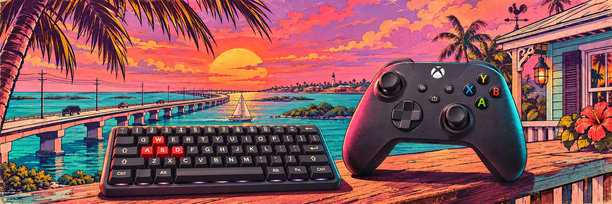

#  KeyWest · Keyboard and mouse for Xbox Remote Play

Got GTA VI on Xbox and a left hand that goes straight to WASD? **KeyWest** turns your keyboard and mouse into a virtual Xbox controller in Chrome or Edge. Hold **W + D** and sweep the mouse toward the ocean. The browser reads both sticks at once, so you can keep moving while you look around.

**[Try the gamepad tester](https://gagarinbefree.github.io/KeyWest/)** · **[Download KeyWest for Chrome or Edge](https://github.com/gagarinbefree/KeyWest/releases/latest)** · **[Open Xbox Remote Play](https://play.xbox.com/remoteplay)**



**What you can try today.** The built-in tester lets you try both sticks, the buttons, and the triggers with just your PC, keyboard, and mouse. Compatibility with a live GTA VI Remote Play session on Xbox Series X or Series S is still unverified. The steps below walk you through trying it on your console.

## Install KeyWest on your PC

1. Open the **[latest release](https://github.com/gagarinbefree/KeyWest/releases/latest)**. Under **Assets**, download **`KeyWest-<version>.zip`**.
2. Extract the ZIP to a folder you can keep, such as `C:\Games\KeyWest`. Find the folder that contains `manifest.json`.
3. Open `chrome://extensions` in Chrome or `edge://extensions` in Edge. Turn on **Developer mode**.
4. Click **Load unpacked** and select the folder containing `manifest.json`. You’ll now find **KeyWest** in the browser’s Extensions menu.

## Try both sticks before you start your Xbox

Open the [online tester](https://gagarinbefree.github.io/KeyWest/) in Chrome or Edge, or click the **KeyWest** icon if you’ve installed the extension. The tester starts in English every time you open or reload it. Click **Русский** next to **GTA FM** to switch to Russian, or **English** to switch back.

Click **Capture mouse**. Hold **W + D**, move the mouse, and press the **left mouse button**. The **Movement** dot moves diagonally, the **Look** dot follows your mouse, and **RT** lights up. Stop moving the mouse while holding the keys. The right stick returns to center while the left stick holds its diagonal. Press **Esc** to release the cursor.


Click **GTA FM** in the upper-right corner to open GTA Classics on laut.fm in a new tab. The equalizer button beside it turns the tester’s radio on or off. If your browser blocks autoplay, click the equalizer to join the live broadcast. [Listen to GTA Classics](https://laut.fm/gta-classics)

## From the Keys to Leonida · Start GTA VI

1. **Get your console ready.** Turn on your Xbox Series X or Series S and confirm that GTA VI launches under your profile. On your Xbox, open **Settings → Devices & connections → Remote features** and select **Enable remote features**. [Xbox Remote Play setup guide](https://support.xbox.com/en-US/help/games-apps/game-setup-and-play/how-to-set-up-remote-play)
2. **Connect from your PC.** Open Remote Play in the browser where you installed KeyWest. Sign in with the Microsoft account you use on your Xbox, select your console, and start the stream. [Open Xbox Remote Play](https://play.xbox.com/remoteplay)
3. **Launch GTA VI.** On the streamed Xbox dashboard, open **My games & apps** and select **Grand Theft Auto VI**. You can keep your Xbox controller paired to your PC over Bluetooth for the console menus.
4. **Switch to keyboard and mouse.** Click inside the stream and press **F8**. Try walking a few steps with **W** while looking around with the mouse. When the game prompts you for an Xbox button, use the table below to find its keyboard or mouse binding.

**Esc** releases the cursor. **F8** toggles capture in the current tab. Switching tabs releases any held inputs. When you return, click inside the stream and press **F8** to take control again.

## Controls at a glance

| Keyboard or mouse | Xbox controller input |
| --- | --- |
| **W / A / S / D** | Left stick forward / left / back / right |
| **Move the mouse** | Right stick (look) |
| **Left / right mouse button** | Right / left trigger (**RT / LT**) |
| **Space / C / R / E** | **A / B / X / Y**, respectively |
| **Q / F** | Left / right bumper (**LB / RB**) |
| **Left Shift / Left Ctrl** | Press left / right stick (**LS / RS**) |

GTA VI assigns an action to each controller input based on your in-game control scheme and what you’re doing. Use the physical controller for the D-pad, menu buttons, and Xbox button.

## If the stream only responds to your controller

- **Your console is missing from Remote Play.** Check that you’re signed in with the correct account, your Xbox is online, and remote features are enabled. [Xbox Remote Play requirements](https://www.xbox.com/en-US/consoles/remote-play)
- **The Remote Play tab was already open when you installed KeyWest.** Reload `play.xbox.com/remoteplay`, reconnect to your console, click inside the stream, and press **F8**. The tester and stream each have their own mouse capture.
- **The tester responds, but the game doesn’t.** Press **Esc** and try the same session with your physical controller. If that works, tell us your browser, your KeyWest version, and the step where input stopped. [Report an issue](https://github.com/gagarinbefree/KeyWest/issues)

<details>
<summary>For developers · Run, test, and build locally</summary>

Use Node.js 24 and pnpm. To run the tester from source, start the development server.

```powershell
pnpm install --frozen-lockfile
pnpm dev
```

Run the checks and build the extension.

```powershell
pnpm test
pnpm run typecheck
pnpm run lint
pnpm build
```

Load the `dist` folder as an unpacked extension. To run static analysis, use `pvs-js analyze . --output pvs-report.json`. GitHub Actions checks pull requests targeting `main` and pushes to `main`. A successful build on `main` publishes a versioned ZIP to GitHub Releases.

</details>

Sponsored by [GTA Classics on laut.fm](https://laut.fm/gta-classics).
