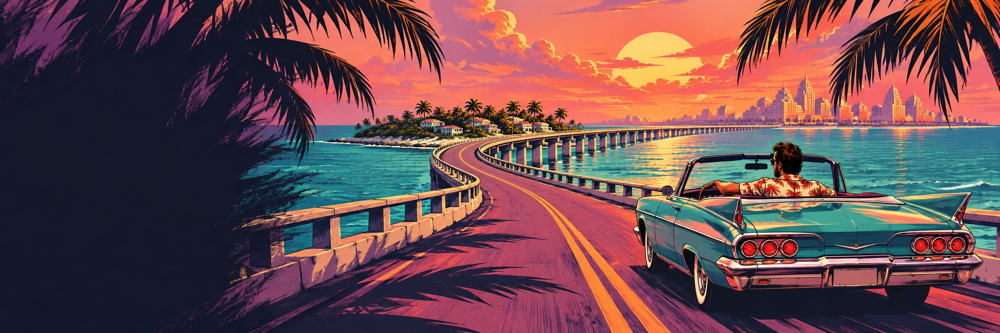
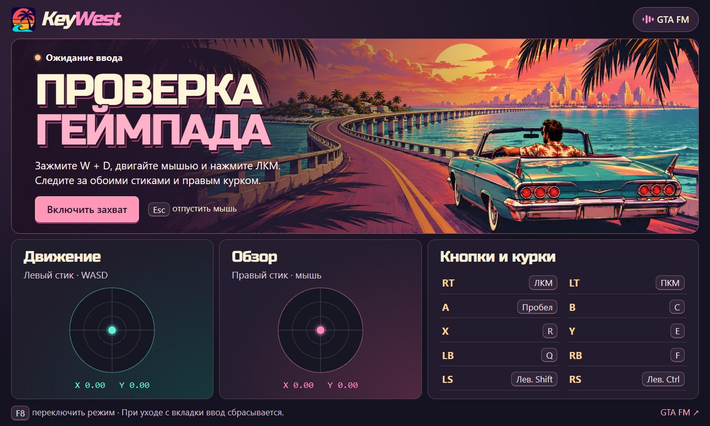

# 🌴 KeyWest · Клавиатура и мышь для Xbox Remote Play

GTA VI установлена на Xbox, а руки сами тянутся к WASD? **KeyWest** превращает клавиатуру и мышь в виртуальный геймпад во вкладке Chrome или Edge. Держи **W + D** и веди мышью в сторону океана — браузер получает движение левого стика и поворот правого одновременно.

**[Скачать KeyWest для Chrome и Edge](https://github.com/gagarinbefree/KeyWest/releases/latest)** · **[Открыть Xbox Remote Play](https://play.xbox.com/remoteplay)**



**Что уже можно попробовать.** На встроенном стенде работают оба стика, кнопки и курки. Для этой проверки хватит ПК с мышью и клавиатурой. Совместимость с живой трансляцией GTA VI на Xbox Series X|S ещё предстоит подтвердить. Ниже — как проверить управление у себя.

## Установи расширение на ПК

1. Открой **[последний релиз](https://github.com/gagarinbefree/KeyWest/releases/latest)**. В разделе **Assets** скачай **`KeyWest-<версия>.zip`**.
2. Распакуй архив в постоянную папку, например `C:\Games\KeyWest`. Внутри должен лежать `manifest.json`.
3. Введи в адресную строку `chrome://extensions` для Chrome или `edge://extensions` для Edge. Включи **Режим разработчика**.
4. Нажми **Загрузить распакованное расширение** и выбери папку с `manifest.json`. Теперь в меню расширений есть **KeyWest**.

## Попробуй оба стика до запуска Xbox

Нажми значок **KeyWest**, затем **Включить захват**. Зажми **W + D**, поведи мышью и, продолжая движение, нажми **левую кнопку мыши**. Точка «Движение» уйдёт по диагонали, точка «Обзор» отклонится вслед за мышью, а **RT** подсветится. Останови мышь, удерживая клавиши: правый стик вернётся в центр, левый останется на диагонали. Нажми **Esc**, чтобы вернуть курсор.



Кнопка **GTA FM** в правом верхнем углу управляет музыкой стенда. Радио выбирает случайный трек из плейлиста GTA и переключается после окончания доступной записи или превью.

## Из Флорида-Кис в Леониду · запуск GTA VI

1. **Подготовь консоль.** Включи Xbox Series X или Series S и убедись, что GTA VI установлена и запускается под твоим профилем. В настройках Xbox открой **Устройства и подключения → Удалённые функции** и включи удалённые функции. [Настройка Remote Play от Xbox](https://support.xbox.com/ru-RU/help/games-apps/game-setup-and-play/how-to-set-up-remote-play)
2. **Открой трансляцию на ПК.** В том же браузере, где установлен KeyWest, войди под учётной записью Microsoft с твоим профилем Xbox. Выбери свою консоль и начни сеанс. [Открыть Xbox Remote Play](https://play.xbox.com/remoteplay)
3. **Запусти игру.** На экране консоли открой **Мои игры и приложения → Grand Theft Auto VI**. Геймпад Xbox можно оставить подключённым к ПК по Bluetooth — он пригодится для меню консоли.
4. **Передай управление клавиатуре и мыши.** Щёлкни внутри трансляции и нажми **F8**. Попробуй пройти несколько шагов на **W** и осмотреться мышью. Когда игра покажет подсказку с кнопкой Xbox, найди её во втором столбце ниже.

**В любой момент:** **Esc** освобождает курсор, **F8** переключает захват. При переходе на другую вкладку KeyWest отпускает нажатые кнопки. Вернувшись в трансляцию, щёлкни по ней и снова нажми **F8**.

## Что нажимать

| На клавиатуре или мыши | На геймпаде Xbox |
| --- | --- |
| **W / A / S / D** | Левый стик — вперёд / влево / назад / вправо |
| **Движение мыши** | Правый стик — обзор |
| **ЛКМ / ПКМ** | Правый / левый курок (**RT / LT**) |
| **Пробел / C / R / E** | **A / B / X / Y** соответственно |
| **Q / F** | Левый / правый бампер (**LB / RB**) |
| **Левый Shift / левый Ctrl** | Нажатие левого / правого стика (**LS / RS**) |

Раскладка описывает сигналы геймпада. Действие в GTA VI зависит от игровой ситуации и выбранной в игре схемы. Для крестовины, кнопок меню и кнопки Xbox используй физический контроллер.

## Если управление осталось на геймпаде

- **Консоли нет в списке Remote Play.** Проверь учётную запись, подключение Xbox к сети и настройку удалённых функций. [Требования Xbox Remote Play](https://www.xbox.com/en-US/consoles/remote-play)
- **После установки вкладка уже была открыта.** Обнови `play.xbox.com/remoteplay`, снова открой трансляцию, щёлкни по ней и нажми **F8**. Захват на стенде и захват в трансляции включаются отдельно.
- **На стенде ввод виден, а игра не реагирует.** Нажми **Esc** и проверь тот же сеанс обычным геймпадом. Если он работает, укажи в отчёте браузер, версию KeyWest и на каком шаге пропадает ввод. [Сообщить о проблеме](https://github.com/gagarinbefree/KeyWest/issues)

<details>
<summary>Для разработчиков · локальный запуск, тесты и сборка</summary>

Нужны Node.js 24 и pnpm. Для запуска стенда из исходников:

```powershell
pnpm install --frozen-lockfile
pnpm dev
```

Для проверки и сборки расширения:

```powershell
pnpm test
pnpm run typecheck
pnpm run lint
pnpm build
```

Загрузи папку `dist` как распакованное расширение. Для статического анализа используй `pvs-js analyze . --output pvs-report.json`. GitHub Actions проверяет pull request и push в `main`, а после успешной сборки `main` публикует версионный ZIP в Releases.

Стенд выбирает русский язык для российских часовых поясов, английский для остальных. При настройке часов на UTC или фиксированное смещение используется регион основной локали браузера.

</details>
